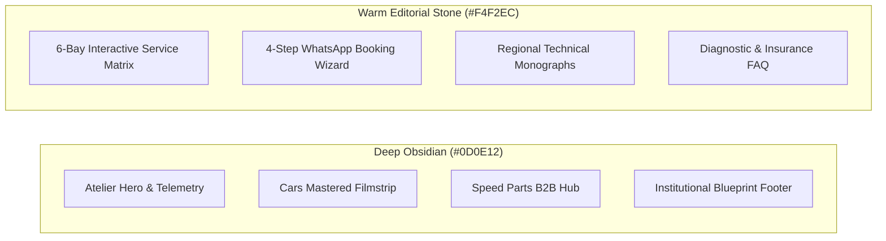
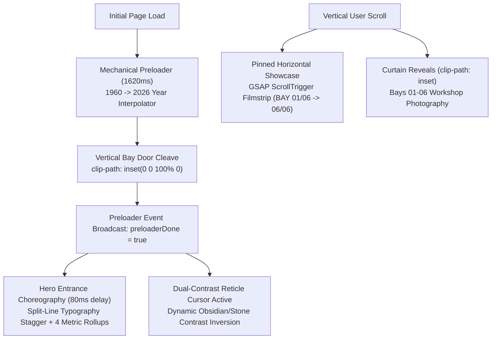

# HINDUSTAN GARAGE (Est. 1960) & SPEED PARTS
### Luxury Animated Automotive Atelier & Genuine OEM Spares Depot · Prayagraj, UP
*Central Workshop: 56, M.G. Marg, Civil Lines · Wholesale Spares Hub: Medical Chauraha, George Town*

[](https://reactjs.org/)
[](https://www.typescriptlang.org/)
[](https://vitejs.dev/)
[](https://tailwindcss.com/)
[](https://greensock.com/gsap/)
[](https://www.w3.org/WAI/standards-guidelines/wcag/)
[](https://vitest.dev/)
[](#3-motion-choreography--animation-suite-pure-2d-high-craft)

---

## 1. Executive Vision & Atelier Heritage

Founded in **1960 on Mahatma Gandhi Marg (Civil Lines)**, **Hindustan Garage** is Prayagraj’s longest-standing automotive engineering landmark. Across 66 continuous years and three generations of master technicians, the institution has evolved from classical coachbuilding and mechanical triage to a modern, multi-bay diagnostic atelier servicing German luxury marques (*Porsche, BMW, Mercedes-Benz, Audi, JLR*) and passenger fleets (*Toyota, Hyundai, Maruti Suzuki, Mahindra, Tata*).

In 2026, the brand expanded with **Speed Parts Prayagraj**, a dedicated retail and B2B wholesale depot located at **Medical Chauraha, George Town**. Speed Parts serves as Eastern Uttar Pradesh’s direct supply chain link for genuine OEM parts—eliminating third-party middleman markups and fulfilling fast counter dispatches across 120+ regional workshops.

This repository hosts the **Luxury Animated Non-3D Web Platform**, designed to translate the visceral precision, grease-machined honesty, and institutional authority of the physical atelier into a digital experience.

---

## 2. Visual Architecture & Design Language

The design system rejects generic AI templates, flat SaaS aesthetics, and neon dark-mode cliches in favor of an **Editorial Dual-Contrast System**:



### Visual Tokens & Color Palette
- **Deep Obsidian (`#0D0E12`)**: High-drama mechanical stage; titanium carbon finish for hero, portfolio, and B2B catalog.
- **Warm Editorial Stone (`#F4F2EC`)**: Glare-free daylight readability for technical matrices, customer booking, and monographs.
- **Surface Crisp White (`#FFFFFF`)**: High-contrast dossier containers and interactive card surfaces.
- **Carbon Ink (`#111215`)**: Authoritative typographic ink across daylight sections.
- **Coachbuilder Crimson (`#B81D13`)**: Heritage institutional mark, active bay callouts, and primary CTAs.
- **Speed Cobalt (`#0F4C81`)**: Genuine OEM parts depot seal and wholesale trade accents.
- **Diagnostic Emerald (`#10B981`)**: Real-time workshop operating status beacon and cashless insurance verifications.

### Typography Hierarchy
* **Headings & Display**: `Inter Tight` (Weights 600, 700, 800) with optical tracking adjustments.
* **Body & Narrative**: `Plus Jakarta Sans` (Weights 400, 500, 600) for effortless technical readability.
* **Telemetry, SKUs & Odometers**: `JetBrains Mono` (Weights 400, 500, 600) with tabular numeral alignment.

---

## 3. Motion Choreography & Animation Suite (Pure 2D High Craft)

The application adheres strictly to a **Non-3D High Craft Mandate**: zero Three.js, zero WebGL, zero canvas shaders. All kinetic feedback is driven by hardware-accelerated 2D transforms (`translate3d`, `scale`) and GPU composite clipping masks.



### Motion Archetypes
1. **Mechanical Preloader (`Preloader.tsx`)**: Minimal year chronometer (`1960 -> 2026`) in `JetBrains Mono` followed by a vertical shutter split (`cubic-bezier(0.16, 1, 0.3, 1)`). Gated to fire the hero section only after shutters complete opening.
2. **Magnetic Reticle Cursor (`MagneticCursor.tsx`)**:
   - High-contrast precision crosshair dot with a damped spring trailing ring (`gsap.quickTo`).
   - Dynamic DOM contrast sensing: dynamically switches border tone from white on `#0D0E12` to carbon black on `#F4F2EC`.
   - Context-aware morphing: expands into interactive badges reading `VIEW BAY` over service bays, `INSPECT` over completed cars, and `WHATSAPP` over speed parts.
   - Automatically disabled on touch screens via `@media (hover: none)`.
3. **Clip-Path Image Curtain Reveals (`CurtainReveal.tsx`)**:
   - Precision non-reflow vertical mask wipe (`clip-path: inset(100% 0% 0% 0%) -> inset(0% 0% 0% 0%)`).
   - Simultaneous `scale(1.10) -> scale(1.0)` settle with `cubic-bezier(0.16, 1, 0.3, 1)`.
   - Re-keyed to bay changes (`key={activeBay.id}`) for instant wipe transitions when tabs are toggled.
4. **Pinned Horizontal Showcase (`PortfolioFilmstrip.tsx`)**:
   - Desktop vertical scrolling pins the viewport and smoothly translates a 6-car photographic gallery horizontally across the screen via GSAP ScrollTrigger.
   - Real-time numerical HUD counter (`BAY 01 / 06` -> `BAY 06 / 06`) and kinetic progress tracking line.
5. **Interactive Technical Drawers (`SpeedPartsB2B.tsx`)**:
   - Zero-reflow expandable drawers revealing genuine OEM photography, direct price comparisons, and 1-click WhatsApp trade dispatch.

---

## 4. Section Architecture & Domain Model

| # | Section | Component | Palette Theme | Core Functionality |
| :-: | :--- | :--- | :--- | :--- |
| **00** | **Preloader** | `Preloader.tsx` | Obsidian | 1960–2026 chronometer rollup + vertical shutter split. |
| **01** | **Navigation** | `Navbar.tsx` | Glassmorphic | Sticky header with live workshop status beacon and quick links. |
| **02** | **Atelier Hero** | `Hero.tsx` | Deep Obsidian | Split-line kinetic headline, trust telemetry (132 Justdial, 6+ Insurance, 150km Catchment), and direct booking CTA. |
| **03** | **Service Matrix** | `ServiceMatrix.tsx` | Editorial Stone | 6 dedicated bays (ECM Diagnostics, Luxury Marque Care, Paint Booth, 3D Geometry, Electrical, Heavy SUV) with interactive dossiers. |
| **04** | **Mastered Cars** | `PortfolioFilmstrip.tsx` | Deep Obsidian | Pinned horizontal scroll filmstrip featuring completed restorations (BMW 530d, Mercedes W213, Audi Q7, Fortuner, Creta DCT). |
| **05** | **Speed Parts B2B** | `SpeedPartsB2B.tsx` | Deep Obsidian | Wholesale OEM parts catalog, Hyundai price leader comparison, interactive hover drawers, and trade enquiry dispatch. |
| **06** | **1960 Heritage** | `LegacyStory.tsx` | Deep Obsidian | 66-year archival chronology from post-independence coachbuilding to high-voltage electric vehicle diagnostics. |
| **07** | **Regional Journal** | `RegionalBlog.tsx` | Editorial Stone | 4 localized technical monographs (Prayagraj heat protection, cashless insurance protocols, wholesale logistics, luxury servicing). |
| **08** | **Dual Hubs & FAQ** | `DualHubContact.tsx` | Editorial Stone | Civil Lines & George Town physical telemetry, interactive map triggers, and 8-topic accordion FAQ. |
| **09** | **Booking Engine** | `BookingEngine.tsx` | Editorial Stone | 4-step daylight booking wizard with bay pre-selection, live review docket, and encrypted WhatsApp payload generation. |
| **10** | **Footer** | `Footer.tsx` | Deep Obsidian | Dual-facility address cards, GPS coordinates, emergency helpline, and copyright legal metadata. |

---

## 5. Directory Layout

```
hb_darkmodern/
├── .gitignore                      # Git ignore rules for node_modules, dist, logs
├── AGENTS.md                       # Engineering guidelines & architectural rules
├── CONTEXT.md                      # Domain ontology, locations, and motion mandates
├── index.html                      # HTML5 root with font preloading & metadata
├── package.json                    # Project dependencies and script declarations
├── postcss.config.js               # PostCSS & Tailwind processing pipeline
├── tailwind.config.js              # Theme tokens, fonts, and animation extensions
├── tsconfig.json                   # TypeScript compiler configuration
├── tsconfig.node.json              # Node TypeScript config for Vite
├── vite.config.ts                  # Vite bundler and Vitest test runner configuration
│
├── docs/
│   ├── ARCHITECTURE.md             # In-depth system design & component contracts
│   ├── ANIMATION_SPEC.md           # Motion choreography, timelines, and easing curves
│   ├── DESIGN_SYSTEM.md            # Dual-contrast color tokens, typography & reticle
│   ├── adr/                        # Architecture Decision Records
│   │   ├── 0001-pure-2d-motion-architecture.md
│   │   ├── 0002-dual-contrast-editorial-system.md
│   │   └── 0003-clip-path-curtain-reveals.md
│   └── agents/                     # AI agent operational guidelines
│       ├── domain.md
│       ├── issue-tracker.md
│       └── triage-labels.md
│
├── public/
│   └── images/                     # 26 High-resolution authentic workshop photographs
│
└── src/
    ├── __tests__/
    │   ├── responsiveAudit.test.tsx # 14 Comprehensive responsive & interaction tests
    │   └── setup.ts                # Vitest & JSDOM test harness setup
    ├── components/
    │   ├── layout/                 # Sticky Navbar & Blueprint Footer
    │   ├── motion/                 # Cursor, Preloader, CurtainReveal, ScrollReveal
    │   └── sections/               # Hero, Matrix, Filmstrip, Parts, Story, Blog, FAQs
    ├── data/                       # Typed data stores (services, cars, parts, blogs, faqs)
    ├── App.tsx                     # Master state orchestrator & section composition
    ├── index.css                   # Tailwind base, typography utility, and reset rules
    └── main.tsx                    # React 18 DOM entry point
```

---

## 6. Installation & Local Development

### Prerequisites
- **Node.js**: $\ge 18.0.0$
- **npm**: $\ge 9.0.0$

### Setup
```bash
# Clone the repository
git clone https://github.com/Arpan-Tyagi/hindustan-garage-darkmodern.git
cd hindustan-garage-darkmodern

# Install dependencies
npm install

# Start development server
npm run dev
# Vite runs at http://localhost:3000/
```

### Automated Testing
```bash
# Run Vitest test suite
npm run test
# Runs 14 comprehensive tests across responsive viewports, contrast tokens, and booking state
```

### Production Build
```bash
# Build optimized production bundle
npm run build
# Runs tsc typechecker and compiles to dist/ with zero errors
```

---

## 7. Quality, Verification & Responsive Certification

- **Zero Horizontal Overflow**: Guaranteed across all screen dimensions from 320px (iPhone SE) to 4K ultra-wide workstations (`scrollWidth <= innerWidth`).
- **Touch Target Accessibility**: All interactive buttons, chips, and navigational tabs meet or exceed the $44 \times 44\text{px}$ minimum tap target standard.
- **Contrast Ratios**: Verified WCAG AA compliant across both Deep Obsidian (`#0D0E12`) and Warm Editorial Stone (`#F4F2EC`) viewports.
- **Hardware Cursor Isolation**: Custom drafting cursor and hover listeners are strictly bypassed on touch devices, maintaining native 120Hz touch scrolling and zero battery waste.

---

## 8. Institutional Attribution

© 1960–2026 **Hindustan Garage & Speed Parts B2B Wholesale Depot**. All Rights Reserved.  
*Central Workshop: 56, M.G. Marg, Civil Lines, Prayagraj, UP 211001*  
*Speed Parts Depot: Medical Chauraha, George Town, Prayagraj, UP 211002*
