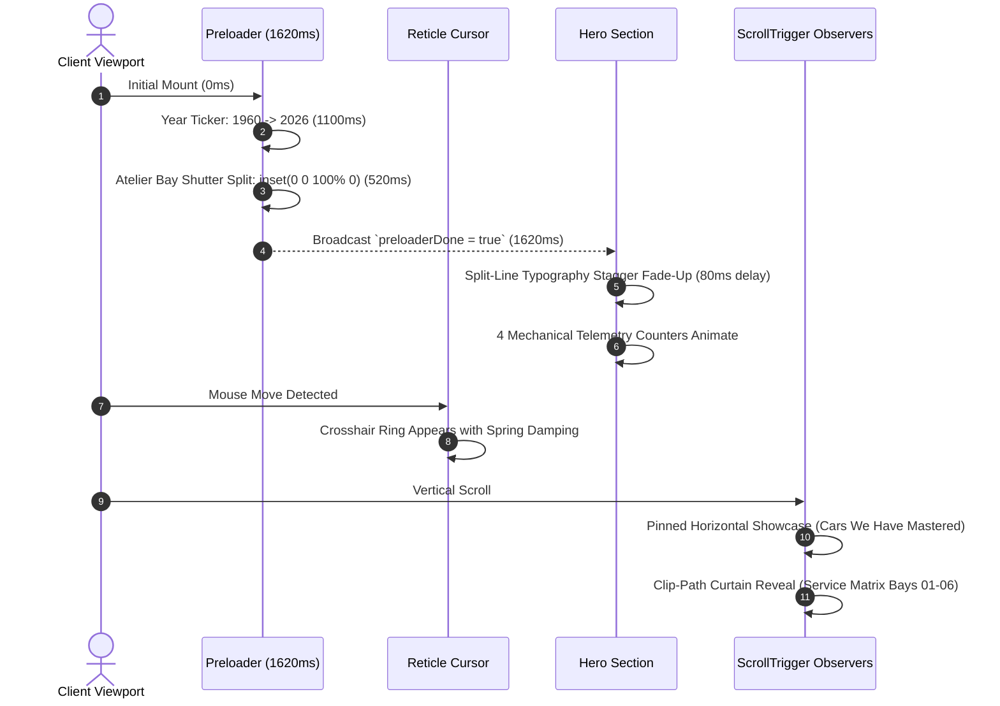

# Hindustan Garage & Speed Parts — Animation & Motion Choreography Specification

## 1. Core Mandate: Pure 2D High Craft

No 3D WebGL, Three.js, or canvas shader dependencies are used in this codebase. High-end luxury interaction is achieved through **pure 2D motion choreography**:

1. **Hardware-Accelerated Compositing**: All animations operate strictly on `transform` (`translate3d`, `scale`) and `opacity` properties, offloading rasterization to the GPU.
2. **Deterministic Easing**: The signature kinetic curve is `cubic-bezier(0.16, 1, 0.3, 1)` (fluid deceleration inspired by Leica aperture rings and high-precision mechanical shutters).
3. **Responsive Degradation**: Full motion enabled on desktop; touch gestures and native 120Hz smooth scrolling respected on touch devices.

---

## 2. Global Choreography Timeline

---

## 3. Component Motion Breakdown

### 1. Preloader (`src/components/motion/Preloader.tsx`)
* **Mechanism**: Fixed overlay (`z-50`) holding two split shutters (top & bottom) with clip-path masks.
* **Phase 1: Chronometer Rollup (0 - 1100ms)**: Numerical interpolation from year `1960` to `2026` in `JetBrains Mono`.
* **Phase 2: Shutter Cleave (1100 - 1620ms)**: 
  * Top half wipes upward: `clipPath: inset(0 0 100% 0)`.
  * Bottom half wipes downward: `clipPath: inset(100% 0 0 0)`.
  * Easing: `cubic-bezier(0.16, 1, 0.3, 1)`.
* **Completion Event**: Fires `onComplete()` callback at `1620ms`, activating `preloaderDone` in `App.tsx`.

### 2. Custom Magnetic Reticle Cursor (`src/components/motion/MagneticCursor.tsx`)
* **Mechanism**: Double-element cursor rendered in root DOM with pointer-events-none:
  * Central dot: instantaneous position tracking (`x`, `y`).
  * Outer ring: damped positional tracking via `gsap.quickTo` with `duration: 0.18s, ease: 'power2.out'`.
* **Dynamic Contrast Awareness**: 
  * Checks mouse target against `.bg-stone, #services, #booking, #blog, #dual-hubs`.
  * Dark surface: ring has `border-white/80`.
  * Light surface: ring has `border-carbon`.
* **Context Morphing**:
  * Scans `data-cursor` and `data-magnetic` attributes on hovered elements.
  * Card hover: transforms ring into a `72px - 80px` filled pill with active contextual label (`VIEW BAY`, `INSPECT`, `WHATSAPP`).

### 3. Split-Path Curtain Reveal (`src/components/motion/CurtainReveal.tsx`)
* **Mechanism**: Non-reflow clipping box utilizing CSS `clip-path`:
  * Hidden state: `clipPath: inset(100% 0% 0% 0%)` (wipes from bottom edge).
  * Visible state: `clipPath: inset(0% 0% 0% 0%)`.
  * Scale settle: `scale-110 -> scale-100` simultaneous with mask expansion.
* **Duration & Curve**: `1000ms`, `cubic-bezier(0.16, 1, 0.3, 1)`.
* **Resilience Guardrails**:
  * Immediate bounding-box calculation (`rect.top < window.innerHeight + 100`).
  * `IntersectionObserver` with `rootMargin: '100px 0px'`.
  * Automatic `450ms` safety timer preventing permanently occluded content.

### 4. Pinned Horizontal Filmstrip (`src/components/sections/PortfolioFilmstrip.tsx`)
* **Desktop Mode**:
  * Utilizes `gsap.registerPlugin(ScrollTrigger)`.
  * Viewport pins when the section enters top: `pin: true, scrub: 1, end: () => "+=" + totalScrollWidth`.
  * Cards glide along horizontal X-axis (`xPercent: -100 * (cards.length - 1)`).
  * Live progress gauge: Updates dynamic fractional counter (`BAY 01 / 06` -> `BAY 06 / 06`) and tracking bar (`0% -> 100%`).
* **Mobile / Tablet Mode**:
  * Seamlessly degrades to native smooth horizontal snap-scroll (`overflow-x-auto snap-x snap-mandatory scrollbar-none`).

### 5. Scroll-Triggered Text & Card Reveals (`src/components/motion/ScrollReveal.tsx`)
* **Mechanism**: Lightweight `IntersectionObserver` wrapper with `threshold: 0.05`.
* **Transform**:
  * Unrevealed: `opacity: 0, transform: translate3d(0, 24px, 0)`.
  * Revealed: `opacity: 1, transform: translate3d(0, 0, 0)`.
  * Duration: `700ms` with configurable stagger delay (`delay` prop).

### 6. Interactive Technical Drawers (`src/components/sections/SpeedPartsB2B.tsx`)
* **Mechanism**: Spec-row expansion with smooth CSS grid/height transitions.
* **Hover State**: Slides open high-resolution genuine part photography, live OEM price comparison badge, and direct `wa.me` wholesale ordering button.
