# Hindustan Garage & Speed Parts — Codebase Architecture

## 1. Directory Structure & Single-Context Layout

```
hb_darkmodern/
├── .gitignore                      # Node, dist, logs, and OS ignore specifications
├── AGENTS.md                       # Engineering guidelines & architectural rules
├── CONTEXT.md                      # Domain ontology, locations, and motion mandates
├── index.html                      # HTML5 root with font preloading & metadata
├── package.json                    # Project dependencies and script declarations
├── postcss.config.js               # PostCSS & Tailwind processing pipeline
├── tailwind.config.js              # Theme tokens, fonts, and animation extensions
├── tsconfig.json                   # TypeScript compiler configuration
├── tsconfig.node.json              # Node TypeScript config for Vite
├── vite.config.ts                  # Vite bundler and Vitest test runner configuration
│
├── docs/
│   ├── ARCHITECTURE.md             # This document (system design & data flow)
│   ├── ANIMATION_SPEC.md           # Motion choreography, timelines, and easing curves
│   ├── DESIGN_SYSTEM.md            # Dual-contrast color tokens, typography & reticle
│   ├── adr/
│   │   ├── 0001-pure-2d-motion-architecture.md
│   │   ├── 0002-dual-contrast-editorial-system.md
│   │   └── 0003-clip-path-curtain-reveals.md
│   └── agents/
│       ├── domain.md               # Domain vocabulary rules for AI agents
│       ├── issue-tracker.md        # Local markdown ticket conventions
│       └── triage-labels.md        # Triage state vocabulary
│
├── public/
│   └── images/                     # 26 High-resolution authentic atelier photographs
│
└── src/
    ├── __tests__/
    │   ├── responsiveAudit.test.tsx # 14 Comprehensive responsive & interaction tests
    │   └── setup.ts                # Vitest & JSDOM test harness setup
    │
    ├── components/
    │   ├── layout/
    │   │   ├── Navbar.tsx          # Sticky glass navigation with telemetry status
    │   │   └── Footer.tsx          # Dual-facility blueprint addresses, maps, legal
    │   │
    │   ├── motion/
    │   │   ├── CurtainReveal.tsx   # Hardware-accelerated clip-path image mask
    │   │   ├── MagneticCursor.tsx  # Dual-contrast reticle cursor with context morphs
    │   │   ├── Preloader.tsx       # 1960->2026 counter + vertical shutter cleave
    │   │   └── ScrollReveal.tsx    # IntersectionObserver GPU translate/opacity reveal
    │   │
    │   └── sections/
    │       ├── Hero.tsx            # Kinetic split-line headline & 4 live counters
    │       ├── ServiceMatrix.tsx   # 6-bay interactive dossier matrix (Stone theme)
    │       ├── PortfolioFilmstrip.tsx # Pinned horizontal GSAP scroll showcase
    │       ├── SpeedPartsB2B.tsx   # B2B genuine wholesale depot with hover drawers
    │       ├── LegacyStory.tsx     # 1960 coachbuilder heritage & archival milestones
    │       ├── RegionalBlog.tsx    # 4 Localized technical journal articles
    │       ├── DualHubContact.tsx  # Interactive FAQ accordion & GPS directions
    │       └── BookingEngine.tsx   # 4-step interactive bay booking modal
    │
    ├── data/
    │   ├── servicesData.ts         # 6 Bay specifications, tooling, and pricing
    │   ├── carsData.ts             # 6 Portfolio vehicles, specs, and turnaround SLAs
    │   ├── partsData.ts            # Genuine OEM parts, wholesale pricing, WhatsApp URLs
    │   ├── blogData.ts             # 4 Regional technical automotive articles
    │   └── faqData.ts              # 8 Comprehensive workshop & insurance FAQs
    │
    ├── App.tsx                     # Master state orchestrator & section composition
    ├── index.css                   # Tailwind base, typography utility, and reset rules
    └── main.tsx                    # React 18 DOM entry point
```

---

## 2. Component Hierarchy & State Flow

```mermaid
flowchart TD
    App["App.tsx<br/>(Master State Orchestrator)"] --> Preloader["Preloader.tsx<br/>(Year Ticker + Shutter Split)"]
    App --> Cursor["MagneticCursor.tsx<br/>(Dual-Contrast Reticle)"]
    App --> Navbar["Navbar.tsx<br/>(Sticky Glass Header)"]
    App --> Hero["Hero.tsx<br/>(Gated on isReady=preloaderDone)"]
    App --> ServiceMatrix["ServiceMatrix.tsx<br/>(6-Bay Dossier Switcher)"]
    App --> Portfolio["PortfolioFilmstrip.tsx<br/>(GSAP Pinned Horizontal Showcase)"]
    App --> SpeedParts["SpeedPartsB2B.tsx<br/>(Wholesale Depot & Hover Drawers)"]
    App --> LegacyStory["LegacyStory.tsx<br/>(1960 Archival Narrative)"]
    App --> RegionalBlog["RegionalBlog.tsx<br/>(4 Localized Monographs)"]
    App --> DualHub["DualHubContact.tsx<br/>(FAQs & GPS Telemetry)"]
    App --> Footer["Footer.tsx<br/>(Dual Facilities & Legal)"]
    App --> BookingEngine["BookingEngine.tsx<br/>(4-Step Modal Wizard)"]
```



### State Synchronization
1. **Preloader Synchronization (`preloaderDone`)**:
   - `App.tsx` maintains `preloaderDone` state.
   - When the preloader finishes its 1620ms sequence, it triggers `setPreloaderDone(true)`.
   - `Hero.tsx` receives `isReady={preloaderDone}`. Hero typography staggers and numerical counter tickers do not fire in the dark; they animate visibly the moment the shutters open.
2. **Booking Engine Orchestration**:
   - `isBookingOpen: boolean` and `selectedBayId: string | null` are hoisted to `App.tsx`.
   - Clicking `"Book This Bay Now"` on any of the 6 bay dossiers in `ServiceMatrix.tsx` automatically pre-selects that bay in the 4-step wizard modal.
   - Final confirmation dynamically constructs an encrypted WhatsApp dispatch payload to `wa.me/918796576868` alongside an interactive visual receipt docket.

---

## 3. Data Contracts & Type Safety

All data structures in `src/data/` are strictly typed via TypeScript interfaces:
* **`ServiceBay`**: ID, bay number, title, subtitle, category, lead technician, turnaround SLA, warranty guarantee, description, tooling hardware array, quality deliverables array, estimated pricing guideline, cashless eligibility, and live workshop bay photograph.
* **`CarMastered`**: ID, vehicle name, year, engine variant, service bay performed, work summary, before/after telemetry delta, turnaround hours, technician lead, and showcase photography.
* **`SpeedPartItem`**: ID, part name, OEM manufacturer, SKU code, vehicle compatibility list, wholesale trade price, retail price, stock level, warranty period, and direct WhatsApp procurement link.
* **`BlogPost`**: Slug, title, category, reading time, published date, author, excerpt, markdown body, and hero photography.
* **`FaqItem`**: Question, answer, category tag.
